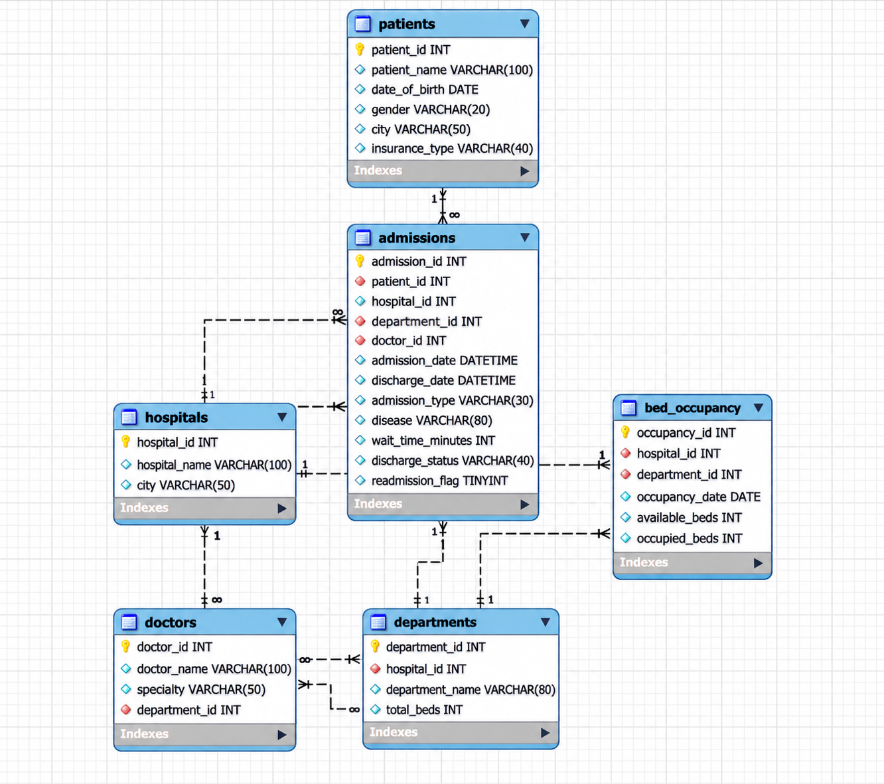

# Apollo Hospitals: Patient Flow SQL Analysis

Department-by-department analysis of waits, bed utilisation, readmissions and length of stay (MySQL 8.0+).

## Files
- `apollo_patient_flow.sql` creates the database, 6 tables, data and indexes (synthetic data, not real patient data)
- `apollo_analysis_queries.sql` the 15 analysis queries (Q1 to Q15)
- `Apollo_Hospitals_Patient_Flow_Analysis.pptx` / `.pdf` the presentation

## How to run
1. Open MySQL Workbench and connect to your local instance.
2. Run `apollo_patient_flow.sql` (File > Open SQL Script, then the lightning bolt).
3. Run any query from `apollo_analysis_queries.sql`.

## Database Schema (ER Diagram)

The following ER diagram illustrates the relationships between the six tables in the hospital database.

## Skills shown
JOINs, GROUP BY / HAVING, CASE, subqueries, CTEs, window functions (DENSE_RANK), EXPLAIN / EXPLAIN ANALYZE query optimisation.

